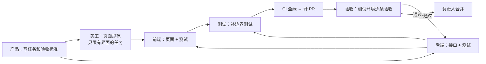

# 开发流程与 6 个 AI 角色

## 角色

| 角色 | 文件 | 负责 | 不能做 |
| --- | --- | --- | --- |
| 产品 | `.claude/agents/product.md` | 把需求拆成任务，写验收标准，维护 roadmap | 写业务代码 |
| 美工 | `.claude/agents/designer.md` | 设计规范、页面布局、样式 | 改后端代码 |
| 后端 | `.claude/agents/backend.md` | 接口定义、数据库、业务逻辑、单元和集成测试 | 改前端、改验收结论 |
| 前端 | `.claude/agents/frontend.md` | 各个后台和官网页面 | 改后端、改设计规范 |
| 测试 | `.claude/agents/tester.md` | 补测试、找边界情况、报缺陷 | 改业务代码 |
| 验收 | `.claude/agents/acceptance.md` | 在测试环境逐条对照验收标准，写验收报告 | 改任何代码 |

写代码的角色不能验收自己的工作；测试和验收角色不能改业务代码。

## 一个任务从开始到验收

## 完成的定义（Definition of Done）

- 验收标准逐条满足，每条都能指到测试或验收报告里的证据。
- 本机按下面「本机检查与 CI 的分工」跑完该跑的检查，CI 全绿（CI 跑全套，是唯一的「通过」标准）。
- 没有演示数据、没有密钥原文、没有注释掉的代码。
- 接口变化同步更新 OpenAPI 文档。
- 新的固定文案走文案表（见下面「固定文案走 key」），不在组件里写死；改了文案的 PR 重新运行 `pnpm copy:export`。
- roadmap 已更新，日志已追加。

## 固定文案走 key（M11-01，业主 2026-11-15 决定）

新页面、新提示、新邮件 / 通知模板的固定文案一律放进文案表，组件和模板只按 key 取，不写死中文。

- **文案表就是 key 机制**（不另建框架）：照 `apps/web/src/lib/checkout-texts.ts` 的写法——文件名以 `-texts.ts` / `-copy.ts` 结尾；中文表必填，日文、英文表可以先空着，取不到时退回中文；带参数的用 `{名字}` 占位，由同一文件里的取文案函数替换。一个页面或一块功能一个表，放在 `apps/web/src/lib/`（共用）或页面目录旁边。
- 后端的邮件 / 通知模板已经是表（`packages/domain/src/notifications.ts`），新模板照样加进表里；接口错误信息不在此列。
- 已有写死的文案不强求一次改完，改到哪个文件就把那个文件里新增的文案放进表；主站已有的日文、英文文案原样保留，不删、不改。
- `pnpm copy:export` 按这个约定统计「已走 key」和「写死」（`docs/copy/README.md`「怎么算已走 key」）。
- **审查时**：看 PR 里 `docs/copy/copy.csv` 的变化，新增的行如果「状态」是「写死」，要求改成走表。

## 本机检查与 CI 的分工（2026-11-10 起，从 M8-19 开始）

两个角色同时在本机共用一个数据库跑全套 `pnpm check`，一次要 1.5 小时左右。改为：

- **本机只跑和改动相关的**：类型检查（`pnpm typecheck`）、lint（如有），加上受影响模块的单元 / 组件测试和对应的集成测试、端到端测试（只跑相关文件，`node --test <文件>`、`pnpm --filter @nozomi/web exec playwright test <文件> --workers=1`）。改了共用模块（`packages/domain`、`packages/config`、`apps/api/src/app.ts`、数据库迁移、接口定义等）时，相关范围要放宽到所有引用它的测试。
- **全套交给 CI**：PR 的 CI（check、e2e、deploy-smoke）全绿才算通过，质量标准不降。CI 有失败一律先查原因；确认是和本改动无关的偶发失败，要在 roadmap 里有对应的去偶发任务，才可以重新触发。
- **必须在本机跑全套时**（例如改了测试基础设施、迁移框架），两个角色错开跑，不要同时跑；开始前先看有没有别的 `pnpm check` / `pnpm test:integration` 进程在跑。
- 交回报告写清本机跑了哪些测试、多少条，以及 PR 的 CI 结果。

### 本机跑端到端时浏览器崩溃（Target crashed / Page crashed）

（M8-29b 登记）本机单线程跑端到端时偶尔报 `Target crashed`、`Page crashed`、`browserContext.newPage: Target crashed`，出在截图、axe、点击、开新页等任意一步（登记过的有 charter-estimate-breakdown、embed-key-delivery、site-booking-waypoints:56、manual-quote、platform-products、site-booking-mobile-address、site-booking-charter）。

- **只在本机出现**：CI 上 2026-11-13 以来全部 150 次失败的运行里没有一次浏览器崩溃（CI 的 Playwright 不重试，崩一次整轮就红，所以失败记录就是全量）。每次本机崩溃时都有别的会话同时在跑集成测试、`vite preview` 或 `tsc`，可用内存只剩一两百 MB；Codespace 只有 2 核、8 GB、`/dev/shm` 64 MB，浏览器渲染进程被系统杀掉。不是断言失败，也不是页面问题。
- **跑之前**：`free -m` 看 available，低于约 1 GB 先等别的会话跑完；`ps aux --sort=-rss | head` 看是谁占着。一律 `--workers=1`、只跑相关文件。端口被别的会话占着时换端口：`E2E_API_PORT=28080 E2E_WEB_PORT=24173 pnpm --filter @nozomi/web exec playwright test <文件> --workers=1`（其余端口跟着这两个走，见 `apps/web/playwright.config.ts`）。
- **崩了以后**：报错是 `Target crashed` / `Page crashed` / `Target page, context or browser has been closed`（不是 `Test timeout`）时，等内存空出来单独重跑那一条，记进交回报告；同一条在内存充足时（available > 1 GB、没有别的会话在跑）仍然崩，才当真问题查。
- **CI 上出现**：按上面「CI 有失败一律先查原因」处理，不能当本机内存问题直接重跑。

### 组件测试的等待上限

组件测试（`apps/web`，happy-dom）的 `findBy*`、`waitFor` 默认等待上限统一放宽到 5 秒（`apps/web/test/register.mjs`，M8-29b）：机器忙时「保存 → 跳页 → 渲染列表」一步就要 0.5～0.9 秒，测试库默认的 1 秒会误报。条件一满足就立即返回，不让测试变慢；单条测试不要再自己加长等待。

## 在 claude.ai/code 里怎么开始一个会话

在 claude.ai/code 选择本仓库，发一句话即可，例如：

> 按 CLAUDE.md 和 docs/workflow.md，做 roadmap 里下一个未开始的任务。

需要指定角色时：

> 用 backend 角色做 M0-05，完成后用 tester 角色补测试，再用 acceptance 角色验收。
